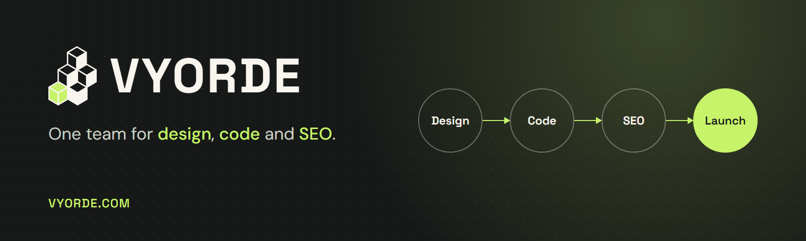

### Hi, I'm Andrei

I build websites and web apps at [Vyorde](https://vyorde.com), a small team based in Moldova that works with small and mid-size companies and startups in Europe, the UK, the US and Canada.

We keep the work plain: you see layouts early, you get a written quote, and the code and the accounts stay yours.

### Stack

**Front end**

**Back end and hosting**

**SEO and analytics**

**Design and motion**

### Contact

[vyorde.com](https://vyorde.com) · [hello@vyorde.com](mailto:hello@vyorde.com)
